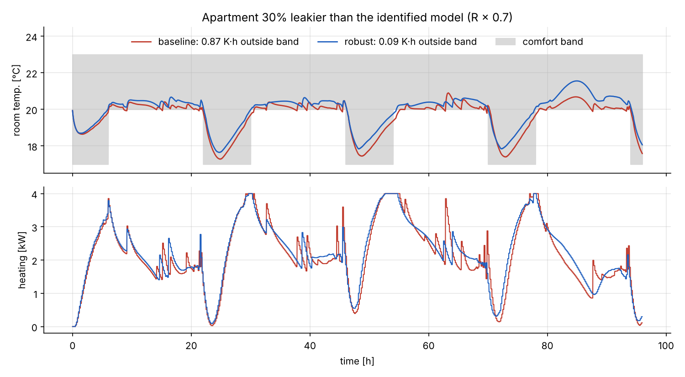
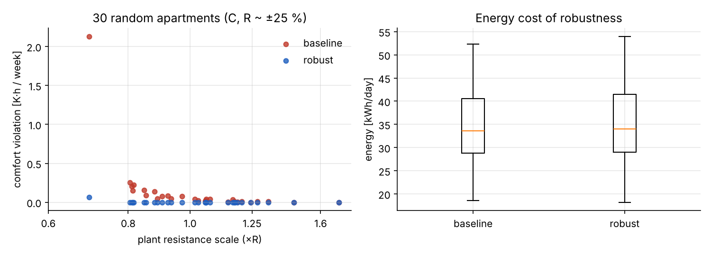
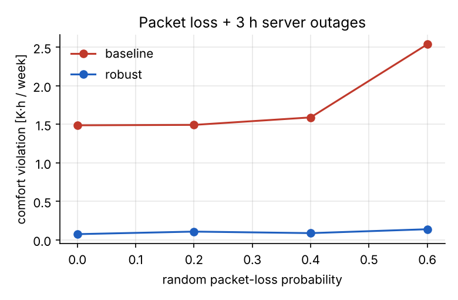
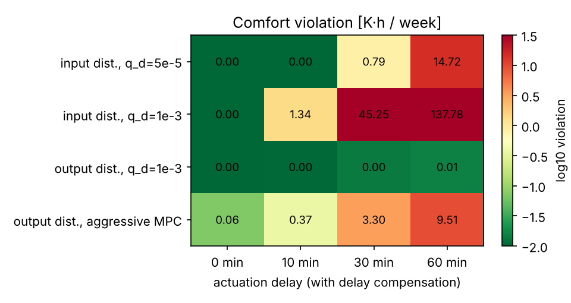

# Robustness of linear MPC for smart thermostats

A small, reproducible study of how a **linear model predictive controller (MPC)
for room heating** behaves when reality does not match its assumptions, and
which simple countermeasures make it robust.

The setting mimics a smart-thermostat system: a server computes an MPC plan from
an *identified* linear room model and sends it over a network to the thermostat
of an apartment. The controller is then exposed to model mismatch, weather-
forecast errors, unmeasured occupancy/solar gains, communication delay, packet
loss, server outages and sensor quantization.



## Setup

```
weather forecast ─┐
                  ▼
 measurement ─► Kalman filter ─► delay compensation ─► economic MPC (QP) ─► network ─► thermostat ─► apartment
     ▲            (offset-free)                         (cvxpy + OSQP)     (delay, loss,  (hold last or     (2R2C plant,
     └─────────────────────────────────────────────────────────────────── outages)        plan buffer)      1-min steps)
```

| Component | What it is |
|---|---|
| **Apartment ("true" plant)** | 2R2C grey-box model: indoor air + building mass, simulated with 1-min steps (`mpcrobust/model.py`). The controller never sees it. |
| **Controller model** | First-order affine ARX model on a 10-min grid, identified from 14 days of excitation data (least squares + output-error refinement, `sysid.py`). Validation on 7 unseen days: free-run RMSE 0.97 K, time constant 27 h, static gain 9.5 K/kW (true: 10.2). |
| **Economic MPC** | 6-h horizon, minimises CO₂-weighted heating energy + input-rate penalty; comfort band 20–23 °C (06:00–22:00) / 17–23 °C (night) as **soft** constraints with slack; optional constraint tightening. Built once with cvxpy parameters, ~3 ms per solve (`mpc.py`). |
| **Offset-free estimator** | Kalman filter with an integrating disturbance, either *input* (d enters the state equation) or *output* (y = T + d) disturbance model (`estimator.py`). |
| **Network + thermostat** | Actuation delay, random packet loss, 3-h server outages; the thermostat either holds the last command or buffers the whole MPC plan (`simulate.py`). |

Two controllers are compared throughout:

- **baseline**: soft-constrained MPC, measured temperature used directly as the state.
- **robust**: + output-disturbance Kalman filter, + delay compensation, + plan buffering on the thermostat, + 0.2 K constraint tightening.

## Results

Comfort violation is the time integral of the distance outside the comfort band
(K·h), over one simulated winter week unless stated otherwise.

| Scenario | baseline | robust |
|---|---|---|
| Nominal | 0.03 K·h | 0.00 K·h |
| 30 random apartments, C and R ±25 % (mean / worst) | 0.13 / 2.13 K·h | 0.00 / 0.06 K·h |
| Outdoor forecast bias +4 K | 0.34 K·h | 0.00 K·h |
| Packet loss 0–60 % + three 3-h server outages | 1.49–2.54 K·h | 0.07–0.14 K·h |
| Thermostat resolution 0.5 K | 0.24 K·h | 0.00 K·h |
| Energy, nominal week | 245.3 kWh | 248.8 kWh (+1.4 %) |

| Monte Carlo over apartments | Packet loss and outages |
|---|---|
|  |  |

## Findings

**1. Structural model mismatch is the main threat, and offset-free estimation removes it.**
A first-order model of a two-time-constant building is always wrong. Without a
disturbance estimate, the MPC sits right at the lower comfort bound and slips
below it whenever the apartment loses heat faster than predicted (worst case
2.13 K·h/week for an apartment 30 % leakier than the model). With the Kalman
filter the error is learned online and the violation drops to ≈ 0, for about
+1.6 % energy.

**2. Hard constraints make the problem infeasible exactly when it matters.**
With hard comfort constraints the QP was infeasible 111 times in one week for
the leaky apartment and 16 times around server outages: once the room is
already below the band, no input can satisfy the constraint in the next step.
Soft constraints (linear + quadratic slack penalty) kept every solve feasible.
This is the practical face of recursive feasibility.

**3. Plan buffering matters more than delay compensation for this system.**
If the thermostat only stores the last command, a 3-h server outage before
06:00 means the morning pre-heating never happens. Storing the full 6-h plan
lets the thermostat keep executing it. With everything else unchanged, plan
buffering alone cut the violation from 1.49 to 0.06 K·h/week in the outage scenario.

**4. The disturbance model decides whether delay compensation is safe.**
Delay compensation predicts the state D steps ahead. With an *input*
disturbance model the estimate d̂ is accumulated D times (T + D·d̂), which
amplifies estimation errors and turned the loop into a limit cycle
(up to 138 K·h/week at 60 min delay). An *output* disturbance model is not
accumulated and stayed at ≈ 0 for all delays. Aggressive tuning (very small
input-rate penalty) re-introduces the problem even with the output model.



**5. Delays of 10–60 min are harmless with sensible tuning.**
The room's time constant (~27 h) is much longer than the delay, so the baseline
stayed below 0.07 K·h/week for delays up to one hour.

Other figures: model validation (`01`), forecast bias (`04`), internal gains
(`05`), delay (`06`), sensor quantization (`09`). Every number above comes from
`results/summary.json`.

## Reproduce

```bash
pip install -r requirements.txt
python experiments/run_all.py           # ~6 min on 2 cores, writes figures/ and results/
python experiments/run_all.py --quick   # short smoke test
pytest -q                               # unit tests (~5 s)
```

## Limitations and next steps

- The plant is simulated (2R2C with synthetic weather and gains), not measured data.
- The robustness study is empirical (closed-loop simulations). A formal analysis
  would add terminal ingredients for nominal stability and a tube or
  constraint-tightening design with guarantees for bounded disturbances.
- Heating power is the decision variable; in a real smart-thermostat system the
  MPC would send set-points to a local controller, which adds its own dynamics.
- Next: validate the framework on measured apartment data, compare with tube MPC,
  and test a second-order controller model.

## References

- J. B. Rawlings, D. Q. Mayne, M. M. Diehl. *Model Predictive Control: Theory, Computation, and Design*, 2nd ed., Nob Hill, 2017.
- J. Drgoňa et al. "All you need to know about model predictive control for buildings." *Annual Reviews in Control* 50 (2020).
- G. Pannocchia, J. B. Rawlings. "Disturbance models for offset-free model-predictive control." *AIChE Journal* 49(2) (2003).
- U. Maeder, F. Borrelli, M. Morari. "Linear offset-free model predictive control." *Automatica* 45(10) (2009).

## Repository layout

```
mpcrobust/      model.py, profiles.py, sysid.py, mpc.py, estimator.py, simulate.py
experiments/    run_all.py, every experiment and figure
figures/        generated plots
results/        summary.json with all metrics
tests/          pytest unit tests
```

Author: Mohamed Ghandour, 2026. MIT licence.
